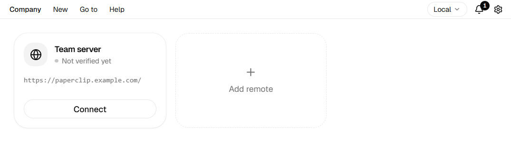
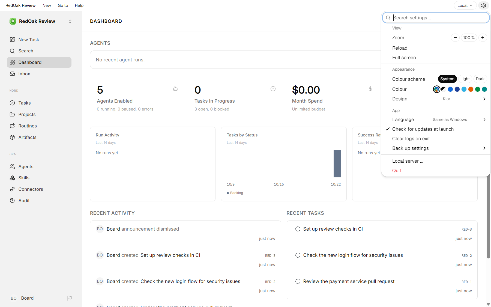
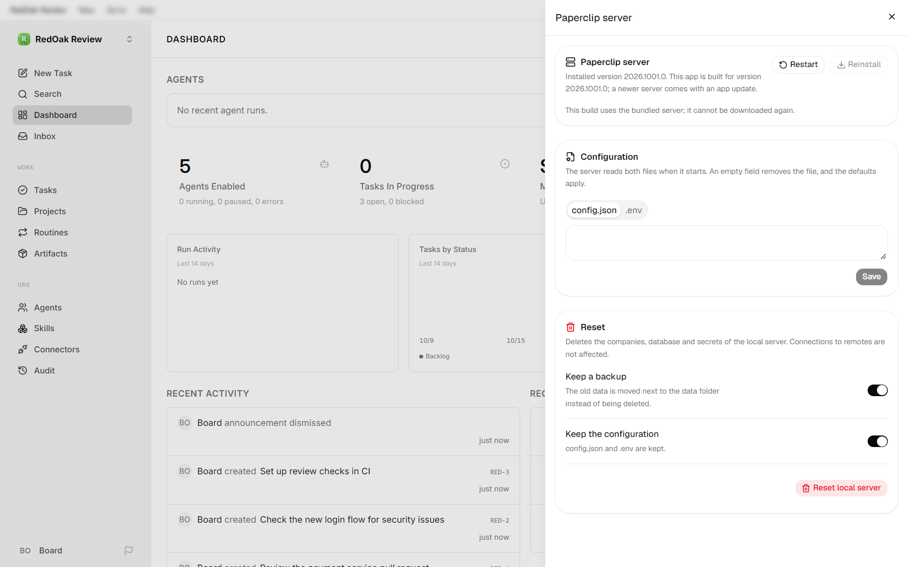

<h1 align="center">PaperclipDesk</h1>

<p align="center"><em>Paperclip as a Windows desktop app: one click starts it on your PC, or connects you to one that runs elsewhere.</em></p>

<p align="center">
  <a href="https://github.com/T-AI-Labs/PaperclipDesk/actions/workflows/ci.yml"></a>
  <a href="https://github.com/T-AI-Labs/PaperclipDesk/releases"></a>
  <a href="https://docs.paperclip.ing/"></a>
  
  
  <a href="LICENSE.md"></a>
</p>

<p align="center">
  <a href="#what-paperclip-does">What Paperclip does</a> ·
  <a href="#install"><strong>Install</strong></a> ·
  <a href="#local-or-remote">Local or remote</a> ·
  <a href="#the-menu-bar">Menu bar</a> ·
  <a href="#the-gear">Settings</a> ·
  <a href="#troubleshooting">Troubleshooting</a> ·
  <a href="#building-from-source">Build</a> ·
  <a href="#license">License</a>
</p>

<p align="center"></p>

<p align="center"><sub>The Paperclip dashboard in PaperclipDesk. The menu bar on top belongs to the app, everything below is Paperclip itself.</sub></p>

## What Paperclip does

[Paperclip](https://docs.paperclip.ing/) runs a company whose employees are AI agents. You set the goal and act as its board; the agents plan, split and do the work, and come to you for the decisions that matter.

| | |
| --- | --- |
| **A company with one goal** | Each company is a self-contained AI organization: a goal, a team of agents, a task board and a budget. You can run several companies side by side. |
| **Agents as employees** | The first agent is the CEO. It reads the goal, proposes a strategy and, once you approve it, creates tasks and hires further agents such as engineers, writers or reviewers. |
| **An org chart** | Agents report to a manager, the CEO reports to you. Work and delegation follow these lines. |
| **Tasks on a board** | The work lives as issues in projects, with statuses, assignees, comments and reviews. You can create and assign tasks yourself at any time. |
| **Work in heartbeats** | Agents do not run all the time. They wake on a schedule, on a new assignment or when you click **Run now**, do their work, report and sleep again. Every run is recorded. |
| **Budgets** | Each agent and the company get a monthly budget. An agent that reaches its limit pauses until you raise it. |
| **You stay the board** | Hires, strategies and budget overrides wait in an approval queue for your yes, no or request for changes. You can pause or terminate any agent. |
| **Your choice of AI** | Adapters connect agents to Claude, Codex, Gemini, a local command or your own HTTP service. Skills teach them how to work, connectors give them access to outside services. |

PaperclipDesk adds a menu for the company in front: switch between companies, open their settings, import or export one, or start a new company from a ready-made template of [Paperclip's catalog](https://github.com/paperclipai/companies). Everything else is Paperclip's own interface; its [documentation](https://docs.paperclip.ing/) explains it in depth.

## TL;DR

- **No terminal, no browser tab.** PaperclipDesk downloads the [Paperclip](https://docs.paperclip.ing/) server, starts it with its database and ends it when you close the window.
- **Local or remote, several at once.** Run Paperclip on this PC, connect to one that already runs on another machine, or keep several remotes open side by side and switch between them with the connection button at the right of the menu bar. Each connection keeps its own login.
- **Paperclip's actions in a real menu bar.** Switch companies, create issues and agents, and jump to the inbox, approvals or costs from menus named after the company in front.
- **Settings without leaving Paperclip.** The gear at the right of the menu bar holds the view, the appearance and the app's options, and opens panels over Paperclip for the local server and your remotes.
- **You stay in control of the server.** See its version, edit its configuration, restart or reinstall it, or reset it with a backup of the old data.
- **Your data stays on your PC.** No account, no telemetry.

## Install

1. Download the latest installer from the [Releases page](https://github.com/T-AI-Labs/PaperclipDesk/releases/latest) and run it.
2. Start **PaperclipDesk** from the Start menu.
3. The welcome page suggests **Start local** to run Paperclip on this PC; the other card connects to a Paperclip that already runs elsewhere. Tick **Start the chosen connection automatically from now on** to skip the page next time.

PaperclipDesk needs Windows 10 or 11 (64-bit). The first local start downloads the Paperclip server, about 530 MB. After that the app updates itself.

## Local or remote

| | Local | Remote |
| --- | --- | --- |
| **Where Paperclip runs** | On this PC, started and stopped by PaperclipDesk | On another machine that you or your team already run |
| **What you need** | Nothing beyond the app | The address of that Paperclip |
| **Your data** | In `%APPDATA%\Paperclip` on this PC | On the remote machine |
| **Login** | None, it is your own PC | The remote's own sign-in, kept per connection |

Before it connects, PaperclipDesk checks a remote: that it answers, that it really is a Paperclip, and that its sign-in is ready. A remote over plain `http://` is only opened after you confirmed that you accept an unencrypted connection.

<p align="center"></p>

The page for remote connections shows each saved remote as a card, with its state and a button to connect, and a card to add a remote. Opening another connection keeps the ones you have open.

The **connection button** at the right of the menu bar names the connection in front. Its menu lists **Local** and your recent remotes with a tick at the open ones: an entry opens its connection or brings it to the front; **Local** starts the local server. **Edit remotes …** opens a panel where you edit, duplicate or delete your remotes, add a new one, and choose under **Open at start** which connections open when the app starts. **Manage remote connections …** at the bottom shows the page for remote connections.

With no connection chosen to open at start, the app starts on the welcome page, which offers the local server and your remotes. **Show this page at every start** on that page, or **Welcome page at every start** in the gear, shows it even when connections are chosen to open at start.

## The menu bar

The menus at the left are about the Paperclip in front; Paperclip's own pages open from them.

| Menu | Entries |
| --- | --- |
| *The company in front* | Your companies with a tick at the one in front, **Company settings**, **Import company …**, **Export company …**, **New company …** and **Company from template …**, which creates a company from a ready-made template of Paperclip's catalog. Its panel sorts them by popularity (the stars of the project each one was made from), recent update or name, and points to Clipmart, PaperclipCloud and usepaperclip.app, filtered by provider and by cost |
| **New** | **New issue …**, **New agent …**, **Search …** |
| **Go to** | **Dashboard**, **Inbox**, **Issues**, **Agents**, **Approvals**, **Costs** |
| **Help** | **Paperclip documentation**, **Report a problem …**, **Log**, **Open data folder**, **Developer tools**, **Check for updates …**, **About PaperclipDesk** with the project page and the third-party licenses |

At the right sit the connection button and the gear.

## The gear

The gear opens the settings as a menu, with a search field on top.

| Section | What you find there |
| --- | --- |
| **View** | Zoom in steps of 10 % from 30 % to 300 %, **Reload**, **Full screen**, **Show menu bar** |
| **Appearance** | The colour scheme (system, light or dark), which Paperclip follows too, an accent colour and 32 designs |
| **App** | The language, **Check for updates at launch**, **Clear logs on exit**, **Welcome page at every start**, and **Back up settings** to export or import them |
| | **Local server …** opens the panel for the local server, **Keyboard shortcuts …** the list of keys; **Quit** ends the app |

<p align="center"></p>

**Local server …** opens the **Paperclip server** panel over Paperclip. It shows the version of the local server, restarts or reinstalls it, has an editor for its `config.json` and `.env`, and resets it.

<p align="center"></p>

### The menu bar and keyboard shortcuts

**Show menu bar** in the gear hides the bar above Paperclip, so Paperclip gets the whole window; **F10** brings it back. In full screen (**F11**) the bar hides by itself and F10 shows it there until you leave full screen. The app's own pages always keep the bar.

**Gear → Keyboard shortcuts …** lists every action of the menus with its key. Search by name or key, click the keyboard button of an action and press the new keys; a key that belonged to another action moves over. Keys need Ctrl or Alt, except F keys, and Ctrl+A, C, V, X, Y and Z stay with text editing. Shortcuts work while the PaperclipDesk window has the focus, also inside Paperclip.

### Resetting the local server

**Gear → Local server … → Reset local server** stops the local server and empties its data: companies, database and secrets. Two switches, both on by default, keep you safe:

- **Keep a backup** moves the old data aside instead of deleting it.
- **Keep the configuration** carries `config.json` and `.env` over.

Connections to remotes are not affected.

### The log

**Help → Log** follows the server's and the app's log live. Filter by level, search, format the server's JSON lines, or collapse every entry to its first line. A button clears the log shown.

## Troubleshooting

| What you see | What to do |
| --- | --- |
| **Local Paperclip could not be started** | Read the message, then **Help → Log** for the server's own output. **Try again** starts it once more. |
| The first local start takes long | It downloads the server and creates the database. Later starts are much faster. |
| A remote is refused | The message names the reason: not reachable, a certificate problem, not a Paperclip, or a sign-in that is not set up yet. |
| Paperclip looks stuck | **Gear → View → Reload**. If that does not help, **Gear → Local server … → Restart**. |
| You want to start over | **Gear → Local server … → Reset local server**, with the backup switch on. |

If nothing helps, [open an issue](https://github.com/T-AI-Labs/PaperclipDesk/issues) and attach the relevant part of the log.

## Building from source

You need Rust, Node.js 24 and Git.

```
npm ci
npm run prepare-server
npm run prepare-server-ui
npm run dev
```

The two `prepare` steps stage the Paperclip server once. The architecture, the rules of the codebase and the release process are in [CLAUDE.md](CLAUDE.md).

## License

PaperclipDesk is licensed under the [MIT License](LICENSE.md): you may use, change and share it for any purpose, commercial use included, as long as the copyright notice and the license text stay with every copy.

Paperclip is a separate project, also under the MIT License. PaperclipDesk downloads and runs its server unchanged. The open-source libraries inside PaperclipDesk are listed in [THIRD_PARTY_LICENSES.txt](THIRD_PARTY_LICENSES.txt) and under **Help → Third-party licenses**.

<p align="center"><sub>PaperclipDesk is an independent project and not affiliated with the Paperclip project.</sub></p>
