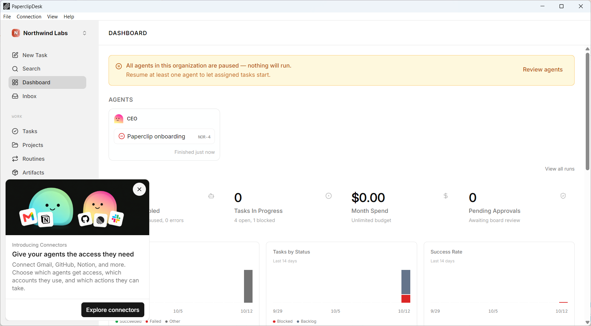

<h1 align="center">PaperclipDesk</h1>

<p align="center"><em>Paperclip as a Windows desktop app: one click starts it on your PC, or connects you to one that runs elsewhere.</em></p>

<p align="center">
  <a href="https://github.com/T-AI-Labs/PaperclipDesk/actions/workflows/ci.yml"></a>
  <a href="https://github.com/T-AI-Labs/PaperclipDesk/releases"></a>
  <a href="https://docs.paperclip.ing/"></a>
  
  
  <a href="LICENSE.md"></a>
</p>

<p align="center">
  <a href="#install"><strong>Install</strong></a> ·
  <a href="#local-or-remote">Local or remote</a> ·
  <a href="#settings">Settings</a> ·
  <a href="#the-menu">Menu</a> ·
  <a href="#troubleshooting">Troubleshooting</a> ·
  <a href="#building-from-source">Build</a> ·
  <a href="#license">License</a>
</p>

<p align="center"></p>

<p align="center"><sub>The Paperclip dashboard in PaperclipDesk, with sample data.</sub></p>

## TL;DR

- **No terminal, no browser tab.** PaperclipDesk downloads the [Paperclip](https://docs.paperclip.ing/) server, starts it with its database and ends it when you close the window.
- **Local or remote.** Run Paperclip on this PC, or connect to one that already runs on another machine. Each connection keeps its own login.
- **Everything in one window.** Paperclip is the main view; settings, the connection page and the log open in the same window.
- **You stay in control of the server.** See its version, edit its configuration, reinstall it, or reset it with a backup of the old data.
- **Your data stays on your PC.** No account, no telemetry.

## Install

1. Download the latest installer from the [Releases page](https://github.com/T-AI-Labs/PaperclipDesk/releases/latest) and run it.
2. Start **PaperclipDesk** from the Start menu.
3. Choose **Local** to run Paperclip on this PC, or **Remote** to connect to an existing one.

PaperclipDesk needs Windows 10 or 11 (64-bit). The first local start downloads the Paperclip server, about 530 MB. After that the app updates itself.

## Local or remote

| | Local | Remote |
| --- | --- | --- |
| **Where Paperclip runs** | On this PC, started and stopped by PaperclipDesk | On another machine that you or your team already run |
| **What you need** | Nothing beyond the app | The address of that Paperclip |
| **Your data** | In `%APPDATA%\Paperclip` on this PC | On the remote machine |
| **Login** | None, it is your own PC | The remote's own sign-in, kept per connection |

Before it connects, PaperclipDesk checks a remote: that it answers, that it really is a Paperclip, and that its sign-in is ready. A remote over plain `http://` is only opened after you confirmed that you accept an unencrypted connection.

The connection page shows every connection as a card: the local server and each saved remote, with its state and a button to open it. Saved remotes also appear in the **Connect** menu, with a tick at the one in use. Under **Settings → Connections** you choose what opens when the app starts: the connection page, the local server, or one of your remotes.

## Settings

**PaperclipDesk → Settings** opens them in the same window. A back button returns you to Paperclip.

| Category | What you find there |
| --- | --- |
| **System** | The language, updates, export and import of your settings, and whether logs are cleared when the app exits |
| **Connections** | The connection opened at start, your saved remotes to edit, duplicate or delete, and the check of a new remote |
| **Server** | The version of the local Paperclip server, restart and reinstall, an editor for its `config.json` and `.env`, and the reset |
| **Appearance** | 31 designs, light and dark mode, and an accent color |

### Resetting the local server

**Settings → Server → Reset** stops the local server and empties its data: organizations, database and secrets. Two switches, both on by default, keep you safe:

- **Keep a backup** moves the old data aside instead of deleting it.
- **Keep the configuration** carries `config.json` and `.env` over.

Connections to remotes are not affected.

### The log

**Help → Log** follows the server's and the app's log live. Filter by level, search, format the server's JSON lines, or collapse every entry to its first line. A button clears the log shown.

## The menu

| Menu | Entries |
| --- | --- |
| **PaperclipDesk** | Settings, Check for updates, Quit |
| **Connect** | This computer, your recent remotes, All connections, Edit remotes |
| **View** | Paperclip, Reload, Zoom from 50 % to 200 %, Full screen |
| **Help** | Paperclip documentation, Project on GitHub, Report a problem, Third-party licenses, Log, Open data folder, Developer tools, the Paperclip version, and About PaperclipDesk |

## Troubleshooting

| What you see | What to do |
| --- | --- |
| **Local Paperclip could not be started** | Read the message, then **Help → Log** for the server's own output. **Try again** starts it once more. |
| The first local start takes long | It downloads the server and creates the database. Later starts are much faster. |
| A remote is refused | The message names the reason: not reachable, a certificate problem, not a Paperclip, or a sign-in that is not set up yet. |
| Paperclip looks stuck | **View → Reload**. If that does not help, **Settings → Server → Restart**. |
| You want to start over | **Settings → Server → Reset**, with the backup switch on. |

If nothing helps, [open an issue](https://github.com/T-AI-Labs/PaperclipDesk/issues) and attach the relevant part of the log.

## Building from source

You need Rust, Node.js 24 and Git.

```
npm ci
npm run prepare-server
npm run prepare-server-ui
npm run dev
```

The two `prepare` steps stage the Paperclip server once. The architecture, the rules of the codebase and the release process are in [CLAUDE.md](CLAUDE.md).

## License

PaperclipDesk is licensed under the [MIT License](LICENSE.md): you may use, change and share it for any purpose, commercial use included, as long as the copyright notice and the license text stay with every copy.

Paperclip is a separate project, also under the MIT License. PaperclipDesk downloads and runs its server unchanged. The open-source libraries inside PaperclipDesk are listed in [THIRD_PARTY_LICENSES.txt](THIRD_PARTY_LICENSES.txt) and under **Help → Third-party licenses**.

<p align="center"><sub>PaperclipDesk is an independent project and not affiliated with the Paperclip project.</sub></p>
